# 🎋 廣零散 (bamboo-saga)

> **「廣納零散思緒，一帖 AI 成丹。」**  
> *Scatter thoughts on bamboo slips; forge an immortal saga with AI.*

**《廣零散 (bamboo-saga)》** 是一款專為開發者與高頻率會議工作者打造的**跨平台極輕量隨手筆記工作台（Scratchpad Hub）**。  
不綁定專案資料夾、完美相容中文注音輸入法（IME），結合 **Gruvbox 中藥百子櫃復古配色**、**Smear Cursor 絲滑殘影游標**、**旗艦級防重開機秒存機制**，以及支援**安全預覽與一鍵回溯（Rollback）的 Groq / Gemini 雙引擎 AI 整理師**。

---

## 📖 命名典故與設計哲學

* **廣零散 (Guang-Ling-San)**：
  * **典故諧音**：取自竹林七賢嵇康之千古絕響《廣陵散》。轉化為「**廣**納**零散**筆記」之意，專治開會、視訊、看 Log 時無處安放的碎片化思緒。
  * **中藥鋪意象**：「散」即傳統中藥散劑。搭配 **Gruvbox Dark** 深褐、暗黃、橘紅、草綠的暖色調，讓每個分頁（散帖）宛如老藥鋪裡的木頭百子櫃；透過 AI 提煉重點的過程則稱為「**收散成丹**」。
* **bamboo-saga**：
  * **Bamboo（竹林 / 竹簡）**：致敬竹林七賢（*Seven Sages of the Bamboo Grove*），亦象徵古人隨手刻寫記事的「竹簡」。
  * **Saga（傳奇史詩 / 分散式長事務模式）**：將每一場漫長曲折的會議或除錯紀錄化為一篇 Saga；同時致敬軟體架構中的 **Saga Pattern**——具備強大的狀態持久化與補償回滾（Rollback）機制，無論系統遭遇任何強制更新或斷電重開，筆記狀態永遠保持最終一致性。

---

## ✨ 專案必備核心功能 (Core Features)

### 1. 🛡️ 旗艦級「防重開機」狀態記憶 (Immortal Persistence)
* **無檔案負擔（Zero-File Overhead）**：不需綁定專案目錄、不需手動按 `Ctrl+S` 取檔名，點開即寫。
* **毫秒級硬碟持久化**：每一次鍵盤敲擊與注音落地，皆於底層即時同步寫入本地儲存空間（Local Vault / SQLite）。
* **全狀態還原**：遭遇 Windows 強制更新重開機、當機或意外關閉時，重新開啟後 100% 原地還原所有開啟的分頁內容、分頁順序、語言模式與**游標所在座標**。

### 2. 🎨 Gruvbox 百子櫃主題 & 即時智慧解析高亮 (Smart Highlighting)
* **純正 Gruvbox Dark 美學**：全介面至程式碼語法樹皆採用 Gruvbox 護眼暖色調。
* **多程式語言 Tree-sitter / Lezer 解析**：原生支援 Markdown、JavaScript/TypeScript、Python、SQL、JSON 等語法高亮與一鍵排版。
* **純文字智慧染色（Smart Plain-Text Tokenizer）**：即使在未指定語言的純文字速記模式下，仍會透過即時正則標記器自動高亮會議關鍵資訊：
  * 🔴 **警示與待辦**：`TODO`、`FIXME`、`BUG`、`ERROR`、`URGENT`、`ACTION`
  * 🟢 **引號與發言**：「中文引號」、『重點』、`"English Strings"`
  * 🟡 **括號與備註**：`()`、`[]`、【系統模組標籤】
  * 🟣 **數據與指標**：時間戳記（如 `10:30`）、效能數據（`3000ms`、`99%`、數字）
  * 🔵 **超連結**：`http://`、`https://` 網址自動標示

### 3. 🧪 智慧 AI 煉丹爐：逐段審核與安全回溯 (AI Refinery & Rollback)

<p align="center">
  
</p>

同時串接 **Groq API**（LPU 極速推論，0.5 秒內回應）與 **Gemini API**（長文本深度整理），並提供**零風險的逐段審核、原文保留與回溯（Transaction Rollback）機制**：
* **逐段審核與心智溯源 (Chunk Review)**：
  * AI 整理後絕不粗暴覆蓋，而是自動切分出結構化卡片串流。
  * 每一段落可獨立自由點選 **「✔ 採納 AI」** 或 **「📝 保留原文」**，重要會議原話、主管叮嚀或口語細節 100% 精確留存，避免被 AI 抹除。
* **三大煉丹心法模式**：
  1. **✨ 收散成丹（會議結構化）**：將中英夾雜、口語零散的速記，自動提煉為「核心結論」、「技術規格重點」與「待辦清單」。
  2. **☑️ 提煉待辦（Action Items）**：自動掃描全文，擷取出 Markdown 核取清單格式的行動項目。
  3. **📐 程式碼與規格重整**：針對選取的 SQL / Log / 規格片段進行自動縮排、補齊標準語言標籤與 Markdown Code Block。
* **🔄 Saga 交易補償回溯機制 (Rollback Guarantee)**：
  * **Pre-AI Snapshot**：觸發煉丹前底層自動建立快照，推入無損復原棧。
  * **一鍵散丹退回**：若對提煉結果不滿意，可隨時點擊頂部審核列的 **「⏪ 退回原散帖 (Rollback)」** 或 Vim `u`，毫秒原地回到原始手稿。

---

### 4. 🪄 隨行行內 AI：選取重構與鍵盤心流 (Inline AI Copilot)

<p align="center">
  
</p>

摒棄干擾中文思緒的行內灰色幽靈預測字（Ghost Text），改採隨按隨至的**浮動隨行提詞器**：
* **選取段落即時喚醒 (`Ctrl + K`)**：在編輯器中選取任意程式碼或文字片段，按下 `Ctrl + K` 即可於游標就地呼喚行內提詞器。
* **四大膠囊快速標籤 (Quick Tags)**：
  * **優雅結構化**：將隨手速記重整為層次分明、排版優雅的 Markdown 結構。
  * **提取待辦**：萃取所有待辦事項，以 Markdown 核取清單 `[-]` 整理。
  * **台灣繁體潤飾**：潤飾用字文筆，全面校準為台灣習慣用語與標準技術名詞。
  * **⚡ 程式碼重構**：校對語法、補齊語言標籤、加上強型別與例外捕捉保護。
* **原地修改置換 (In-Place Rewrite)**：提煉成果直接在選取範圍內就地更新替換，游標座標與手感維持原地，不跳視窗、零中斷鍵盤心流。

---

### 5. ⏳ 本地歷史時光機：專業雙欄 Diff 比對 (Local History & Time Machine)

<p align="center">
  
</p>

免 Git 依賴，即享有專業級 IDE 的本機版本演進追蹤與災難復原保障：
* **全自動多層級快照**：
  * 🏷️ **AI 煉丹前快照 (Pre-AI Snapshot)**：AI 介入前的原始稿自動打標。
  * ⏱️ **定時自動備份**：底層背景非同步輪詢建立關鍵編輯節點。
  * 📌 **自訂里程碑標籤**：重要規格確認時可自訂命名版本。
* **Side-by-Side 雙欄 Git-Style Diff**：
  * 仿 Git 專業雙欄對比視窗，左欄為歷史快照（紅色刪除標記 `-`）、右欄為當前編輯稿（綠色新增標記 `+`）。
  * 即時計算變更統計指標（`+Additions / -Deletions`）。
* **⏪ 一鍵無損還原 (One-Click Revert)**：看中任一歷史節點，點擊按鈕即可 100% 無損還原回該版本，並支援歷史快照複製與標籤管理。

---

### 6. 🗄️ 隨手速寫 × AI 自動判斷位置儲存 (Smart Save Recommender)

<p align="center">
  
</p>

徹底告別「隨手開了新分頁，卻不知道該存在哪裡、該取什麼檔名」的存檔焦慮：
* **零檔案負擔（Zero-File Overhead）**：平常隨手開帖即寫，底層自動秒存。
* **語意特徵深度掃描 (`Ctrl + S`)**：按下智能存檔時，AI 在 **0.8 秒內** 深度剖析筆記與代碼內涵（如程式語言、技術名詞、架構主題）。
* **自動推導本機目錄骨架**：自動掃描比對使用者本機現存的洞天目錄架構，智慧推薦最相符的歸檔子資料夾（如 `src-tauri/src/watcher/` 或 `notes/backend/`）。
* **語義化命名與一鍵歸櫃**：自動推薦標準日期與語義結合的檔名（如 `2026-10-22_tauri_file_watcher_架構.rs`），按 `Enter` 一鍵精準歸檔入櫃！

---

### 7. 🗂️ 多分頁工作台與系統右鍵整合 (Multi-Tab & OS Integration)
* **百子櫃多分頁（Scratchpad Tabs）**：支援無限新增分頁、雙擊重新命名、拖曳排序與快速切換。
* **單一視窗攔截（Single-Instance Routing）**：內建跨平台單一實例鎖定。從系統檔案總管點擊或透過右鍵選單「**用 廣零散 收入藥帖**」開啟外部檔案時，**絕不彈出新視窗**，而是自動將檔案內容轉為現有視窗的新分頁並聚焦。

---

### 8. ☄️ Smear Cursor 物理殘影游標 & 原生 Vim 操作
* **60fps 阻尼殘影游標（Smear Cursor）**：於編輯器上層覆蓋獨立透明 `<canvas>`，利用頭尾雙阻尼插值演算法，在游標大幅移動（如 Vim 的 `w`、`b`、`gg`、`G` 或搜尋跳轉）時，繪製帶有 Gruvbox 亮橘至金黃漸層的動態拖尾特效。
* **Vim 模式無縫支援**：完整支援 Normal / Insert / Visual / Ex 指令操作，且在瀏覽器/WebView 原生核心加持下，**100% 正常顯示 Windows 微軟注音與 Linux 輸入法組字框与選字清單**。

---

## 🛠️ 技術架構 (Tech Stack)

| 層級 | 採用技術 | 選擇理由 |
| :--- | :--- | :--- |
| **跨平台桌面容器** | **Tauri v2 (Rust)** | 安裝包僅 ~4MB，0.2 秒極速冷啟動；原生支援 Windows 11 與 Arch Linux (Wayland/Hyprland)。 |
| **前端響應式框架** | **Svelte 5 (Runes)** | 無虛擬 DOM 開銷，利用 `$state` 極簡管理多分頁、快照堆疊與游標座標狀態。 |
| **核心編輯器引擎** | **CodeMirror 6** | 模組化程度極高，內建 `@replit/codemirror-vim` 與自訂 ViewPlugin 正則染色器。 |
| **視覺特效層** | **HTML5 Canvas 2D** | 獨立於 DOM 渲染之外的 60fps Smear Cursor 物理粒子拖尾畫布。 |
| **AI 推論雙引擎** | **Groq API + Gemini API** | Groq (`llama-3.3-70b`) 負責毫秒級即時排版；Gemini (`gemini-2.5-flash`) 負責長篇會議總結與問答。 |

---

## 🔄 AI 煉丹與 Rollback 狀態流轉設計


```text
[原始手稿 (散帖)] 
       │
       ├── 1. 觸發「✨ 收散成丹」或「💬 AI 問答」
       ▼
[建立快照 Snapshot #N] ──(推入 Undo/Rollback Stack)
       │
       ├── 2. 寫入 AI 整理結果，頂部浮現【🔍 審核列】
       ▼
┌────────────────────────────────────────────────────────┐
│ ✨ 已套用 AI 整理結果  [✅ 確認收丹]  [⏪ 一鍵退回原稿] │
└────────────────────────────────────────────────────────┘
```
